# Maekel System Architecture

**Product:** Maekel — Addis Ababa super-app  
**Clients:** Flutter (Android APK + Web QA hosts)  
**Backend:** Fastify microservices behind an HTTP gateway  
**Modules:** Ride · Food · Market · Events · Games  
**Platform:** Identity · Chat  
**Version:** 1.0 (as-built)  
**Date:** 2026-11-24  

This document describes the **running system** used for local development and the Render + Neon demo/QA deploy. Proposed future splits (separate media/places/notification services) are noted only where relevant.

---

## 1. Goals & constraints

| Goal | How Maekel meets it |
|------|---------------------|
| One phone → one identity, many roles | `identity-service` issues JWT; modules enforce roles |
| Independent module delivery | Separate Node apps + Postgres DB per service |
| Clear data ownership | No shared writable tables across modules |
| Ethiopia launch (Addis) | ETB, E.164 `+251`, mock OTP for QA, subcity places |
| Flutter-only clients (MVP) | Gateway exposes mobile-friendly REST; media via gateway URLs |
| Demo on free cloud | Single-process demo boot on Render; Neon Postgres |

**Non-goals today:** multi-region HA, white-label tenants, production SMS provider, card payments, separate media/places microservices.

---

## 2. System context (whole product)

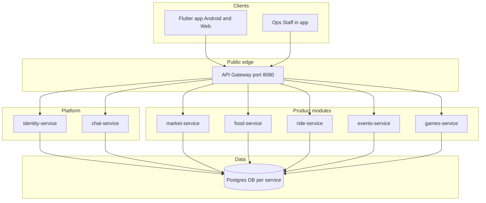

---

## 3. As-built service map

| Service | Port | Public prefix | Owns |
|---------|------|---------------|------|
| **gateway** | 8080 | `/`, `/healthz` | Reverse proxy only |
| **identity-service** | 3001 | `/v1/auth`, `/v1/me`, `/v1/admin` | Users, OTP, JWT, role grants |
| **market-service** | 3002 | `/v1/market` | Ads, categories, favorites, reports, seller ops, ad photos |
| **food-service** | 3003 | `/v1/food` | Merchants, menu, cart, orders, riders, merchant media |
| **ride-service** | 3004 | `/v1/ride` | Quotes, trips, drivers, places seed, ride ops |
| **chat-service** | 3005 | `/v1/chat` | Threads + messages (Market chat) |
| **games-service** | 3006 | `/v1/games` | Profiles + leaderboard scores |
| **events-service** | 3007 | `/v1/events` | Events, RSVP/tickets, check-in, event photos |

**Database-per-service (Postgres):**

| Database | Service |
|----------|---------|
| `maekel_identity` | identity |
| `maekel_market` | market |
| `maekel_food` | food |
| `maekel_ride` | ride |
| `maekel_chat` | chat |
| `maekel_games` | games |
| `maekel_events` | events |

---

## 4. Architecture principles (locked)

1. **Microservice per module** — deploy and migrate independently.  
2. **Gateway is the only public API** for the app (media file GETs also go through gateway prefixes).  
3. **Database per service** — integrate via HTTP, never cross-DB joins.  
4. **Identity issues tokens; modules authorize** — JWT `sub` + roles; privileged routes check roles.  
5. **Media lives in the module that needs it (MVP)** — market / food / events store image bytes in Postgres `BYTEA` (`media_objects`) and serve via `/v1/.../media/files/:filename`.  
6. **Idempotent logistics writes where it matters** — trip/order style flows avoid duplicate active work.  
7. **One userId, many roles** — passenger and driver (or buyer and seller) share one phone login.

---

## 5. Flutter client architecture

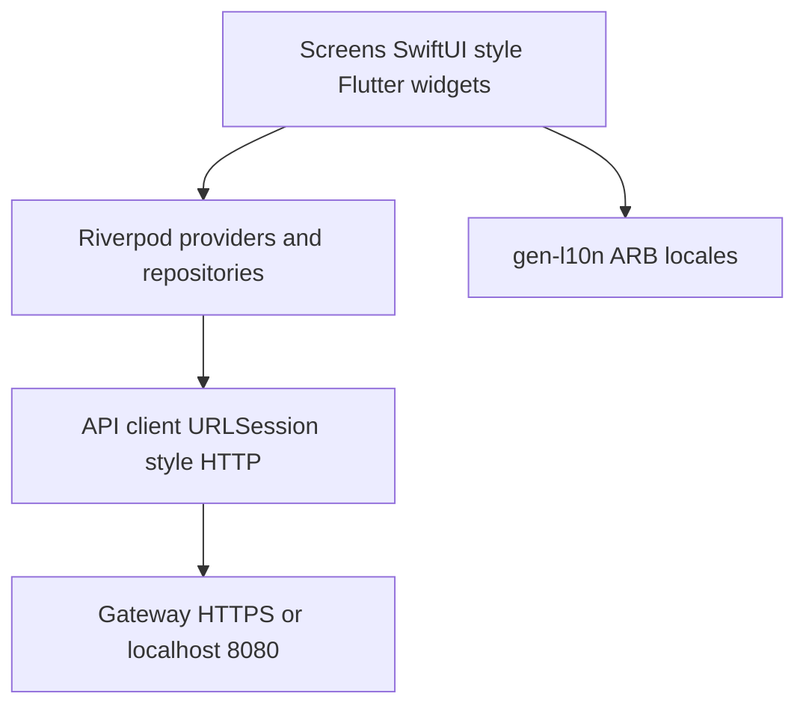

| Concern | Implementation |
|---------|----------------|
| State | Riverpod (`Provider` / `Notifier`) |
| Navigation | `go_router` + `AppRoutes` |
| Networking | Shared HTTP client; `API_BASE_URL` dart-define |
| Auth session | Tokens after OTP; attached on authed calls |
| Locales | en, am, ti, om, aa, so, **ar (RTL)**, sw, zh |
| Modules | `lib/features/{ride,food,market,events,games,auth,admin,home}` |

**Release targets**

| Target | Notes |
|--------|-------|
| Android APK | `--dart-define=API_BASE_URL=https://maekel-api.onrender.com` |
| Web QA | Cloudflare Pages `maekel.pages.dev` + GitHub Pages backup |
| Local | Gateway `http://127.0.0.1:8080` (emulator `10.0.2.2:8080`) |

---

## 6. API Gateway

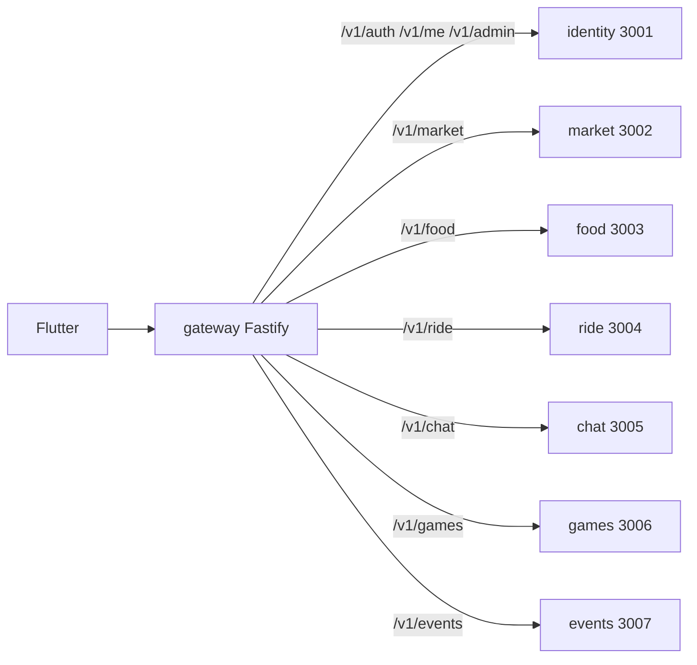

- Package: `@fastify/http-proxy`  
- Forwards path prefix unchanged (`rewritePrefix` = prefix)  
- Body limit raised for multipart image uploads (12 MB)  
- `GET /` returns route list; `GET /healthz` for probes  

---

## 7. Identity, roles & auth flow

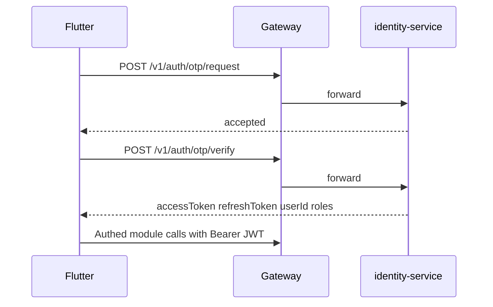

### Auth rules

- Phone normalized to E.164 (`+251` + 9 digits).  
- QA / demo: `MOCK_OTP_CODE` (default `828694`).  
- `ADMIN_PHONES` bootstrap `platform_admin` (+ market moderator) on first verify.  
- Staff UI can grant/revoke roles via `/v1/admin/roles/*`.  

### Role examples

| Area | Roles |
|------|--------|
| Ride | passenger (default), `ride_driver` (ops approve) |
| Food | customer (default), merchant owner/staff, food rider |
| Market | buyer (default), seller (on post), `market_moderator` |
| Events | organizer (host), ops for approve/suspend |
| Platform | `platform_admin` |

---

## 8. Data ownership

| Service | Typical entities |
|---------|------------------|
| identity | users, otp_challenges, sessions/tokens, role_grants |
| market | categories, sellers, ads, ad photos/media_objects, favorites, reports, config |
| food | merchants, menu_items (+ modifiers), carts, orders, delivery jobs, places, media_objects |
| ride | drivers, vehicles, fare config, quotes, trips, trip events, seed places |
| chat | threads, participants, messages |
| games | player profiles, scores |
| events | organizers, categories, events (`image_urls`, cover), tickets, media_objects |

**Media pattern (market / food / events):** multipart upload → row in `media_objects` → public URL  
`{PUBLIC_API_BASE}/v1/{module}/media/files/{uuid}.jpg` served as raw bytes with cache headers.

---

## 9. Module deep dives

### 9.1 Ride

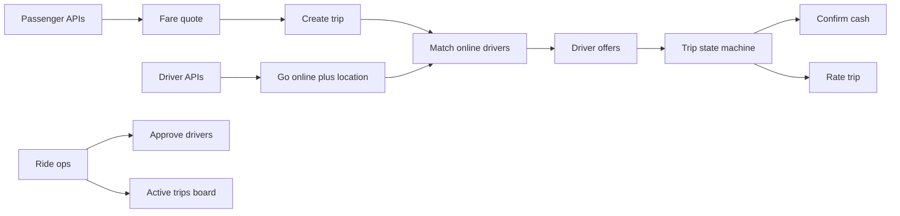

**Invariants**

- Binding fare quote on trip create  
- Driver online requires approved driver role/vehicle  
- Cash confirmation on driver side for MVP payment  
- Ops can cancel active trips / tune fare config  

### 9.2 Food

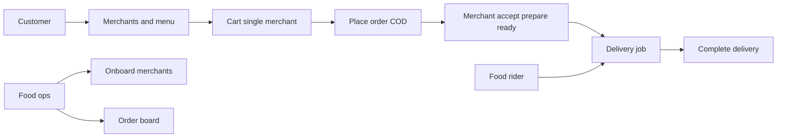

**Invariants**

- One merchant per cart (MVP)  
- Order status machine advances via merchant/rider/ops endpoints  
- Food riders ≠ Ride drivers (separate tables/roles)  
- Menu/item images via food media endpoints  

### 9.3 Market

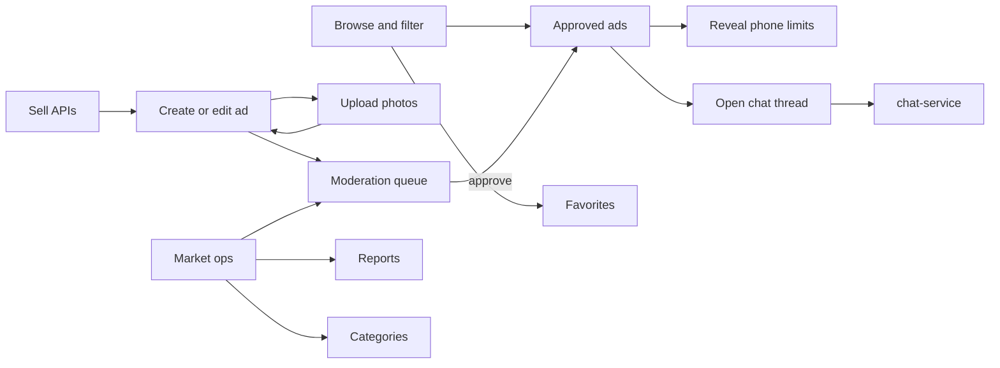

**Invariants**

- Ads are not public until **approved**  
- Chat ownership is `chat-service`; market stores `threadId`  
- No goods checkout/payment in MVP  
- Daily phone-reveal limits via market config  

### 9.4 Events

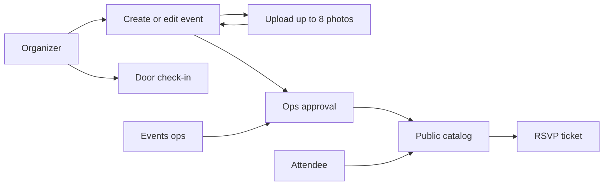

**Invariants**

- `image_urls` array; `cover_url` = first image  
- Capacity cannot drop below tickets sold  
- Check-in validates ticket code for approved/ended events  

### 9.5 Games

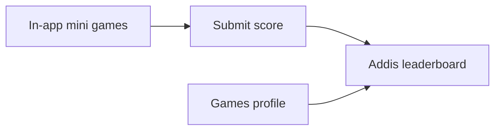

Client-side games (Tetris, brick breaker, candy, road fighter) submit scores to `games-service`.

### 9.6 Chat

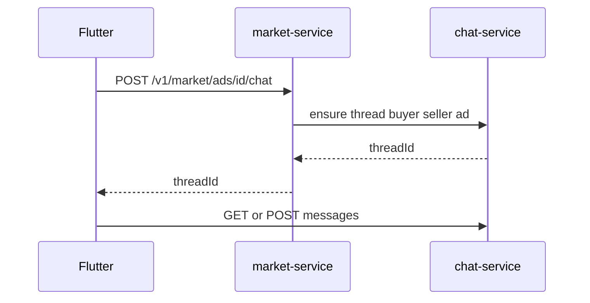

---

## 10. Cross-cutting concerns

### 10.1 Security

- HTTPS on Render; local HTTP for dev  
- JWT access tokens; never log secrets  
- OTP rate limits / mock code only in non-prod  
- Multipart image type + size limits  
- Ops routes require elevated roles  

### 10.2 Observability

- Per-service Fastify logs  
- `GET /healthz` on gateway (and services via shared helper)  
- Render free tier cold-starts (~30–60s after idle)  

### 10.3 Configuration

| Variable | Purpose |
|----------|---------|
| `PUBLIC_API_BASE` | Absolute URLs embedded in media responses |
| `POSTGRES_*` / `POSTGRES_SSL` | DB connectivity (Neon needs SSL) |
| `JWT_SECRET` / `JWT_ACCESS_TTL_SEC` | Token crypto |
| `MOCK_OTP_CODE` | Demo OTP |
| `ADMIN_PHONES` | Bootstrap admins |
| `*_URL` / `*_PORT` | Service discovery for gateway + local boot |

### 10.4 Localization

- Flutter ARB + `flutter gen-l10n`  
- Place names stay English in API filters; UI maps via `localizedPlace`  
- Arabic enables RTL through Flutter Material/Widgets delegates  
- Font fallbacks: Noto Sans Ethiopic, Noto Sans Arabic, Noto Sans SC  

---

## 11. Deployment topology

### 11.1 Local development

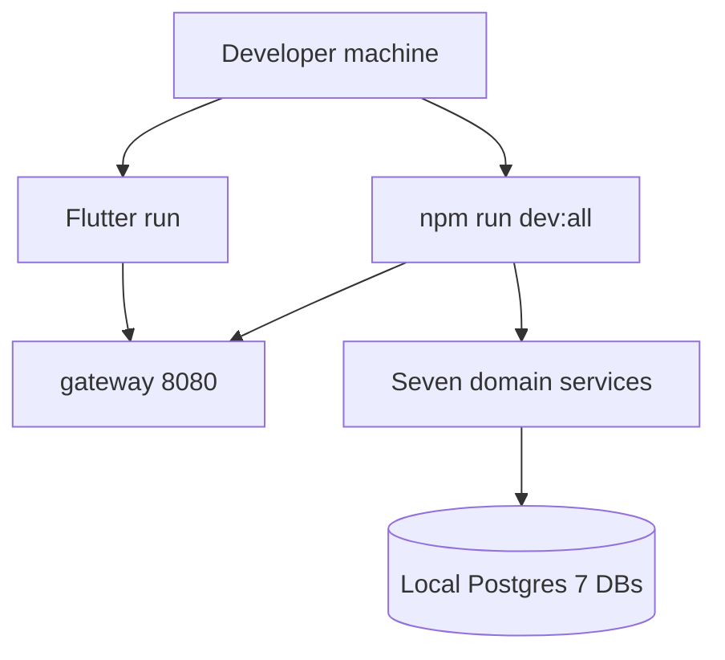

See [local-dev-setup.md](./local-dev-setup.md).

### 11.2 Demo / QA cloud

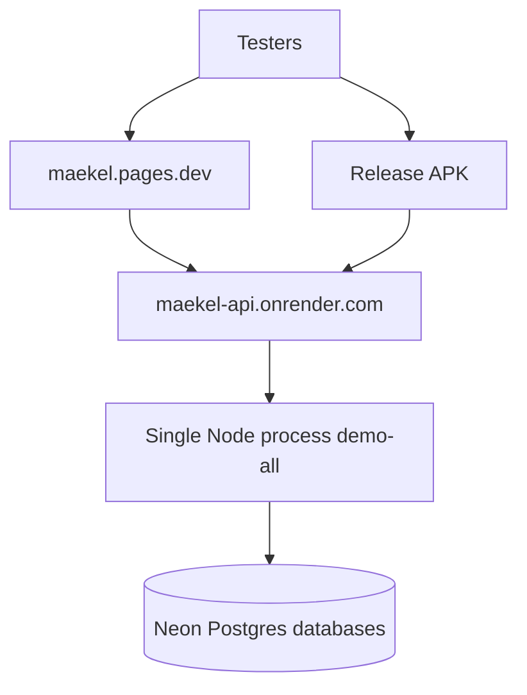

| Piece | Detail |
|-------|--------|
| API | Render web service `maekel-api`, blueprint `render.yaml` |
| Boot | `npm run start:demo` → all services in one process |
| DB | Neon; SSL on; pooled host recommended |
| Web | Cloudflare Pages + GitHub Pages |
| How-to | [how-to-deploy.md](./how-to-deploy.md) |

### 11.3 Production-oriented evolution (not required for QA)

- Split demo process → one container/service each  
- Managed Redis for ride geo if matching load grows  
- Dedicated object storage instead of BYTEA  
- Real SMS OTP + FCM push service  
- Optional event bus for notifications  

---

## 12. Tech stack (as-built)

| Layer | Choice |
|-------|--------|
| Mobile / Web UI | Flutter + Riverpod + go_router |
| Gateway & APIs | Node.js 22, Fastify, TypeScript, Zod |
| Shared lib | `@maekel/shared` (createService, env, DB pool, errors) |
| Auth | JWT + mock OTP |
| DB | PostgreSQL (local or Neon) |
| Images | Multipart → Postgres BYTEA |
| Cloud demo | Render + Neon |
| Web hosting | Cloudflare Pages, GitHub Pages |

**Monorepo layout**

```text
maekel/
  lib/                    Flutter app
  backend/
    apps/
      gateway/
      identity-service/
      market-service/
      food-service/
      ride-service/
      chat-service/
      games-service/
      events-service/
    packages/shared/
    scripts/demo-all.ts
  docs/
  render.yaml
```

---

## 13. Key API surface (summary)

| Prefix | Capabilities |
|--------|----------------|
| `/v1/auth/*` | OTP request/verify |
| `/v1/me` | Current user |
| `/v1/admin/*` | Staff roles |
| `/v1/market/*` | Catalog, sell, media, favorites, chat hook, ops |
| `/v1/food/*` | Merchants, cart, orders, merchant/rider/ops |
| `/v1/ride/*` | Quotes, trips, driver, ops |
| `/v1/chat/*` | Threads, messages |
| `/v1/games/*` | Profile, scores, leaderboard |
| `/v1/events/*` | Catalog, host, media, RSVP, check-in, ops |

---

## 14. Failure modes & resilience

| Failure | Expected behavior |
|---------|-------------------|
| Render cold start | First request slow; wake via `/healthz` |
| chat-service down | Market listing still works; chat CTA fails |
| Duplicate trip/order taps | Server rejects or returns existing active work |
| Oversized image | 413 / validation error from multipart limits |
| Neon sleep / SSL misconfig | Services fail to boot; check `POSTGRES_SSL` |

---

## 15. Security & compliance checklist

- [x] Phones stored/normalized as E.164  
- [x] Mock OTP gated by env (not for real prod SMS)  
- [x] Module role checks on ops/driver/merchant routes  
- [x] Media type/size validation  
- [ ] Production SMS provider + hashed OTP at rest  
- [ ] Formal location retention policy  
- [ ] Secrets only in host secret stores (not git)  

---

## 16. Document map

| Doc | Role |
|-----|------|
| [architecture.md](./architecture.md) | This file |
| [how-to-deploy.md](./how-to-deploy.md) | Deploy API, web, APK |
| [local-dev-setup.md](./local-dev-setup.md) | Local stack |
| [deploy-demo-render-neon.md](./deploy-demo-render-neon.md) | Render + Neon first setup |
| [deploy-web-qa.md](./deploy-web-qa.md) | Web hosts |
| Module FRDs | Ride / Food / Market requirements |
| QA guides | Step-by-step + phones/roles |

---

## 17. Document history

| Version | Date | Notes |
|---------|------|-------|
| 0.1 | 2026-11-15 | Proposed architecture (Nest-oriented, extra platform services) |
| **1.0** | **2026-11-24** | **As-built rewrite: Fastify services, Events/Games, media BYTEA, deploy topology; PDF diagrams pre-rendered** |
