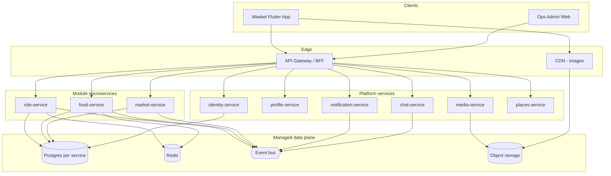
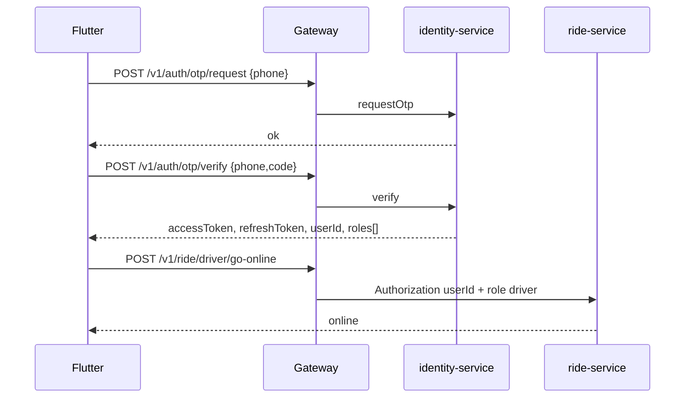
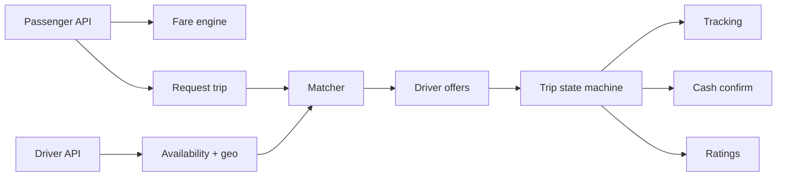
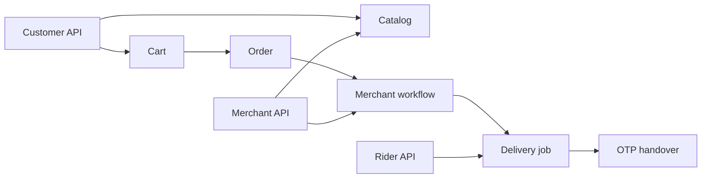
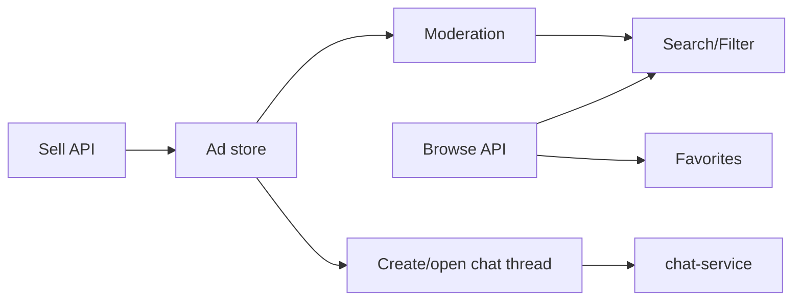
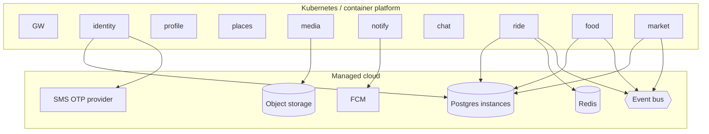

# Maekel System Architecture

**Product:** Maekel — Addis Ababa super app (Flutter)  
**Modules:** Ride · Food · Market · (Games stub client-only for now)  
**Backend style:** **Microservice per product module**, plus shared platform services  
**Aligned to:** [MVP cut](./mvp-cut-ride-food-market.md), [Ride FRD](./ride-functional-requirements.md), [Food FRD](./food-delivery-functional-requirements.md), [Market FRD](./market-functional-requirements.md)  
**Version:** 0.1  
**Status:** Proposed architecture (ready for engineering lock)

---

## 1. Goals & constraints

| Goal | Implication |
|------|-------------|
| One phone → one identity, many roles | Central **Identity** service; modules grant roles |
| Independent module delivery | Deploy/scale Ride ≠ Food ≠ Market |
| Clear data ownership | No shared writable DB across modules |
| Realtime where needed | Ride location/matching; Food order events; Market chat |
| Ethiopia launch (Addis) | ETB, +251, SMS OTP provider, local wallets later |
| Flutter-only mobile clients (MVP) | BFF/API Gateway exposes mobile-friendly HTTP + WebSocket/SSE |

**Non-goals (architecture v0.1):** multi-region active-active, multi-tenant white-label, Games backend, full loyalty ledger.

---

## 2. High-level context



---

## 3. Architecture principles

1. **Microservice per module** — `ride-service`, `food-service`, `market-service` own their domain APIs, DBs, and deploy cycles.  
2. **Platform services are shared** — identity, profile, places, media, notifications, chat are not “modules”; they are reusable infrastructure domains.  
3. **Database per service** — no cross-service joins; integrate via APIs and events.  
4. **Sync for commands, async for facts** — HTTP/gRPC for request/response; event bus for “TripStarted”, “OrderDelivered”, “AdApproved”.  
5. **Gateway is the only public entry** for mobile/admin (except CDN for media).  
6. **Idempotency on money/logistics commands** — place ride request, place food order, payment confirm.  
7. **Same user across sides** — roles (`passenger`, `driver`, `customer`, `merchant_staff`, `food_rider`, `buyer`, `seller`, `admin`) attached to one `userId`.

---

## 4. Client architecture (Flutter)

```text
lib/
  app/                 # MaekelApp, router, theme
  core/                # network, auth session, DI, logging, constants
  features/
    auth/
    home/
    ride/              # passenger + driver UI
    food/              # customer (+ merchant/rider modes later)
    market/            # browse + sell + messages
    games/             # stub
```

| Concern | Approach |
|---------|----------|
| Navigation | `go_router` |
| State | Riverpod (session + feature notifiers) |
| Networking | Single `ApiClient` → Gateway base URL; attach Bearer access token |
| Realtime | WebSocket (or SSE) channels scoped by module: `/ws/ride`, `/ws/food`, `/ws/chat` |
| Auth storage | Secure storage for refresh token; access token in memory |
| Offline | Optimistic drafts (Market sell draft, Food cart local); hard fail at place-order/request-ride |

Client never talks to module services directly in production.

---

## 5. Edge: API Gateway / Mobile BFF

**Responsibility**

- TLS termination, rate limiting, request logging  
- JWT validation (or opaque token introspection via identity)  
- Route `/v1/ride/*` → ride-service, `/v1/food/*` → food-service, etc.  
- Aggregate **lightweight** mobile responses only where needed (e.g. Home badges)  
- CORS for admin web  

**Suggested public API shape**

```text
/v1/auth/*
/v1/me/*
/v1/places/*
/v1/media/*
/v1/notifications/*
/v1/chat/*
/v1/ride/*
/v1/food/*
/v1/market/*
/v1/admin/*
/ws                        # multiplexed or path-prefixed realtime
```

Gateway does **not** contain business rules for matching, fare, cart, or moderation.

---

## 6. Microservice catalog

### 6.1 Module services (one per product module)

| Service | Domain ownership | MVP must expose |
|---------|------------------|-----------------|
| **`ride-service`** | Trip request, fare quote, matching, trip lifecycle, driver availability, ratings, ride earnings ledger | Passenger request/track/complete; driver online/accept/complete; cash fare |
| **`food-service`** | Merchants, menus, carts, orders, delivery jobs, OTP handover, delivery fees | Browse food+grocery; cart; COD order; status; merchant accept; rider OTP complete |
| **`market-service`** | Categories, ads, favorites, moderation state, seller listings | Browse/search; post ad; moderate; favorites; report |

Each module service:

- Has its **own Postgres schema/database**  
- Publishes domain events  
- Consumes identity `userId` as foreign reference (string/UUID), not a FK to identity DB  
- May call platform services synchronously (profile, media, places, notify, chat)

### 6.2 Platform services

| Service | Why shared |
|---------|------------|
| **`identity-service`** | Phone OTP, tokens, sessions, role grants/revokes |
| **`profile-service`** | Display name, avatar, prefs; thin user projection for UI |
| **`places-service`** | Saved Home/Work/pins; geocode helpers; shared by Ride + Food |
| **`media-service`** | Upload URLs, image processing, CDN keys (Market ads, Food menus, avatars) |
| **`notification-service`** | FCM push fan-out; templates; device token registry |
| **`chat-service`** | Threads/messages (Market MVP; Ride optional reuse) |

### 6.3 Optional later services (not MVP)

| Service | Trigger to split |
|---------|------------------|
| `payment-service` | Multiple wallets, refunds, Market premium billing |
| `loyalty-service` | Feres Miles–class rewards |
| `dispatch-optimizer` | Heavy Ride matching algorithms |
| `search-service` | Elasticsearch/OpenSearch for Market at scale |
| `games-service` | If Games needs accounts/scores |

Until then, keep payment stubs **inside** the module that needs them (Ride cash confirm; Food COD; Market no goods checkout).

---

## 7. Identity, roles & “both sides, one phone”



**Rules**

- One `userId` per phone number (E.164, e.g. `+2519…`).  
- Roles are claims and/or server-side grants:  
  - Ride: `ride_passenger` (default), `ride_driver` (after ops approve)  
  - Food: `food_customer` (default), `food_merchant`, `food_rider`  
  - Market: `market_buyer` (default), `market_seller` (implicit on first post)  
  - Ops: `admin`, `moderator`, `dispatcher`  
- Module services **enforce** role on privileged endpoints; Gateway only authenticates identity.  
- Driver/merchant approval lives in module + mirrored role grant via identity API/event.

---

## 8. Data ownership (database per service)

| Service | Primary store | Typical entities |
|---------|---------------|------------------|
| identity | Postgres | User, Phone, OtpChallenge, Session, RoleGrant |
| profile | Postgres | Profile, DevicePreference |
| places | Postgres | Place, GeocodeCache |
| media | Postgres + Object storage | Asset, UploadSession |
| notification | Postgres | DeviceToken, NotificationLog |
| chat | Postgres (+ Redis pub/sub) | Thread, Participant, Message |
| **ride** | Postgres + Redis | Driver, Vehicle, FareQuote, Trip, TripEvent, DriverLocation (hot in Redis) |
| **food** | Postgres + Redis | Merchant, MenuItem, Cart, Order, DeliveryJob, DeliveryOtp |
| **market** | Postgres | Category, Ad, AdPhoto, Favorite, ModerationDecision, Report |

**Redis use**

- Ride: geospatial driver index, offer locks, idempotency keys  
- Food: active order fan-out / short-lived locks  
- Chat: presence / pub-sub  
- Gateway/identity: rate limits  

**No shared Postgres** across ride/food/market.

---

## 9. Inter-service communication

### 9.1 Synchronous (HTTP or gRPC internal)

| Caller | Callee | Example |
|--------|--------|---------|
| Gateway | any | External request routing |
| ride-service | profile-service | Driver card display fields |
| food-service | places-service | Validate saved address |
| market-service | media-service | Attach photo asset IDs |
| any module | notification-service | “Send push to userId” |
| market-service | chat-service | Ensure thread for ad+buyer+seller |
| any module | identity-service | Check/grant role (admin flows) |

Prefer **timeouts + retries with idempotency keys** on writes.

### 9.2 Asynchronous (event bus)

**Bus:** Kafka / NATS / RabbitMQ (pick one; see §15).

| Event (examples) | Publisher | Consumers |
|------------------|-----------|-----------|
| `identity.user.registered` | identity | profile (create stub) |
| `identity.role.granted` | identity | modules cache invalidation |
| `ride.trip.completed` | ride | notification; (later loyalty) |
| `food.order.status_changed` | food | notification; chat optional |
| `market.ad.approved` | market | notification; search indexer later |
| `media.asset.ready` | media | market/food |
| `chat.message.created` | chat | notification |

Modules must remain available if a consumer is down (at-least-once delivery + idempotent handlers).

---

## 10. Realtime design

| Channel | Mechanism | Payload focus |
|---------|-----------|---------------|
| Ride tracking | WebSocket from Gateway → ride-service | Driver lat/lng, trip status |
| Food order | WebSocket or push+poll hybrid | Order status transitions |
| Chat | WebSocket via chat-service | New messages, read receipts later |

**Ride location path (MVP)**

1. Driver app posts location every N seconds to `ride-service` (or gateway WS).  
2. `ride-service` writes Redis geo + latest point; persists trail sampling to Postgres.  
3. Passenger subscribed to `tripId` receives location updates.

---

## 11. Module deep dives

### 11.1 `ride-service`



**Critical invariants**

- Idempotent `POST /trips` (client `Idempotency-Key`)  
- Binding fare quote ID referenced by trip  
- Single active trip per passenger (configurable)  
- Driver cannot go online without `ride_driver` role + approved vehicle  

**Internal packages (same deployable, not separate microservices yet):** matching, pricing, trip-state — split only when scaling demands.

### 11.2 `food-service`



**Critical invariants**

- Single-merchant cart in MVP  
- Status machine matches FRD; Delivered requires OTP  
- Delivery riders are **not** Ride drivers (separate role + tables)  

### 11.3 `market-service`



**Critical invariants**

- Ads not publicly listed until Approved  
- Chat is owned by `chat-service`; market stores `threadId` reference  
- No goods payment in MVP  

---

## 12. Cross-cutting concerns

### 12.1 Security

- HTTPS everywhere; HSTS at edge  
- Short-lived access JWT + refresh rotation  
- OTP rate limits per phone/IP  
- PII minimization; no tokens in logs  
- Masked calling: integrate provider later; MVP may dial direct with rate limits  
- Admin routes behind extra role checks + audit log  

### 12.2 Observability

- Structured logs with `requestId`, `userId`, `module`  
- Metrics: trip match time, order OTP success, ad approve latency  
- Tracing: Gateway → service (OpenTelemetry)  
- Per-service health: `/healthz`, `/readyz`  

### 12.3 Idempotency & consistency

- Write APIs accepting `Idempotency-Key`  
- Outbox pattern (or transactional inbox) for reliable event publish from Postgres  

### 12.4 File uploads

1. Client asks `media-service` for signed upload URL  
2. Client uploads to object storage  
3. `media.asset.ready` → module attaches asset ID to ad/menu/avatar  

---

## 13. Admin / ops

Thin **Admin Web** (or Flutter Web) talks to Gateway `/v1/admin/*`, which routes to:

| Ops need | Service |
|----------|---------|
| Suspend user / grant roles | identity (+ module flags) |
| Approve drivers / vehicles | ride-service |
| Onboard merchants / reassign delivery | food-service |
| Moderate ads / handle reports | market-service |
| Push test / templates | notification-service |

Do **not** build one mega-admin DB; compose via APIs.

---

## 14. Deployment topology



**Environments:** `dev` · `staging` · `prod`  
**CI/CD:** build per service; independent version tags; contract tests at Gateway  
**Secrets:** cloud secret manager; never in git  

**Local dev:** Docker Compose with all services + Postgres/Redis; Flutter points at local Gateway.

---

## 15. Recommended tech stack (proposed lock)

> Frontend is already Flutter. Backend choices below optimize for microservice-per-module + Ethiopia MVP.

| Layer | Recommendation | Notes |
|-------|----------------|-------|
| Gateway/BFF | **NestJS** or **Envoy + small BFF** | NestJS faster for mobile aggregation |
| Module & platform APIs | **NestJS (TypeScript)** *or* **Go** for Ride hot path | Pick **one** primary language for team velocity; Go optional for `ride-service` later |
| Primary language (default) | **TypeScript / NestJS** for all MVP services | Same patterns, shared libs (`auth-guard`, `otel`, `outbox`) |
| DB | **PostgreSQL** (DB-per-service) | Strong consistency for orders/trips/ads |
| Cache / geo | **Redis** | Ride driver geo, locks, rate limits |
| Event bus | **NATS** (simpler MVP) or **Kafka** (if already standard) | Prefer NATS JetStream for MVP size |
| Object storage | **S3-compatible** | Images |
| Push | **Firebase Cloud Messaging** | Via notification-service |
| SMS OTP | Local aggregator / Twilio-class provider | Behind identity-service |
| Maps | Google Maps / Mapbox | Flutter + server geocode |
| Admin web | Next.js or Flutter Web | Calls same Gateway |
| Containers | Docker + Kubernetes (or ECS) | Service-per-deploy |
| Auth tokens | JWT access + refresh | Issued by identity-service |

**Explicitly not the MVP backbone:** Firebase/Firestore as system of record for Ride/Food (realtime toy OK for prototypes only). Use FCM as a **push channel**, not the domain database.

### Shared libraries (monorepo option)

```text
backend/
  apps/
    gateway/
    identity-service/
    profile-service/
    places-service/
    media-service/
    notification-service/
    chat-service/
    ride-service/
    food-service/
    market-service/
  libs/
    auth/
    events/
    tracing/
    errors/
```

**Monorepo + independently deployable services** is preferred so contracts stay aligned without forcing a monolith.

---

## 16. MVP service slice (what to build first)

| Phase | Ship |
|-------|------|
| M0 | Gateway + identity + profile + notification (FCM) |
| M1 | media + places |
| M2 | **market-service** + chat-service + admin moderate |
| M3 | **food-service** (customer/merchant/rider APIs) |
| M4 | **ride-service** (passenger/driver + matching + WS tracking) |

Matches product build order in the MVP cut (Market → Food → Ride) after shell platform.

---

## 17. Failure modes & resilience

| Failure | Behavior |
|---------|----------|
| notification-service down | Domain write succeeds; push retries from outbox |
| chat-service down | Market posting still works; contact CTA degraded |
| Redis down | Ride matching degraded/fail closed; do not corrupt trips |
| Duplicate client submit | Idempotency returns original trip/order |
| Partial deploy | Gateway feature flags hide unfinished module routes |

---

## 18. Security & compliance checklist

- [ ] Phone numbers stored normalized; access audited  
- [ ] OTP codes hashed/TTL; brute-force lockout  
- [ ] Driver location retention policy documented  
- [ ] Media scanned for abuse size/type limits  
- [ ] Admin actions append-only audit  
- [ ] Secrets rotated; least-privilege DB users per service  

---

## 19. Open decisions (need product/eng lock)

1. NestJS-everywhere vs Go for `ride-service` day one  
2. NATS vs Kafka  
3. Masked-number provider for Ride/Market calls  
4. Single Postgres cluster with separate databases vs separate instances  
5. Admin as Next.js vs Flutter Web  

---

## 20. Document map

| Doc | Role |
|-----|------|
| [architecture.md](./architecture.md) | This file — system & microservices |
| [mvp-cut-ride-food-market.md](./mvp-cut-ride-food-market.md) | What to build first |
| [ride-functional-requirements.md](./ride-functional-requirements.md) | Ride behavior |
| [food-delivery-functional-requirements.md](./food-delivery-functional-requirements.md) | Food behavior |
| [market-functional-requirements.md](./market-functional-requirements.md) | Market behavior |

---

## 21. Document history

| Version | Date | Notes |
|---------|------|-------|
| 0.1 | 2026-11-15 | Initial full architecture; microservice per module + platform services |
