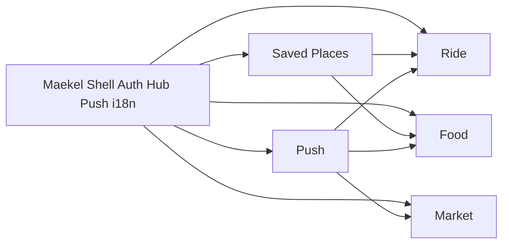

# Maekel MVP Cut — Ride · Food · Market

**Purpose:** Single build contract for the first real product slice of Ride (Feres-like), Food (beU-like), and Market (Jiji-like) inside the Maekel super app.  
**Sources:** [ride](./ride-functional-requirements.md) · [food](./food-delivery-functional-requirements.md) · [market](./market-functional-requirements.md)  
**Version:** 0.1  
**Geography / defaults:** Addis Ababa first · ETB · +251 · en + Amharic-ready UI strings  
**Shell prerequisite:** Shared phone OTP auth, Home hub, routing, theme, session (already planned in Maekel Flutter shell)

---

## 1. MVP north star

One Maekel login. From Home, a user can:

1. **Ride** — request a car, track driver, pay cash, rate  
2. **Food** — order from a restaurant/grocery, track status + OTP handover, pay COD (and optionally one digital wallet)  
3. **Market** — browse/post classifieds, chat/call seller, favorite ads  

Everything else in the full FRDs is **post-MVP** unless listed below.

---

## 2. Shared shell (required for all three)

| Include in MVP | Exclude from MVP |
|----------------|------------------|
| Phone + OTP auth (real or staged backend) | Social login (Google/Facebook) |
| Home hub tiles: Ride, Market, Food (+ Games stub OK) | Cross-module loyalty ledger |
| Shared profile: name, phone | Full unified wallet UX beyond module pickers |
| Shared saved places/addresses (at least Food; Ride pickup/dropoff can reuse) | Deep “Book Ride to meetup” / “Deliver this ad” handoffs |
| Push notifications plumbing | SMS for every event |
| en locale; `am` wiring with English placeholders OK | Full Amharic content translation |
| Role awareness: Ride passenger/driver; Market buyer/seller same account | Separate native driver/merchant binaries (modes inside Maekel OK) |

**Routes (MVP minimum):**

```text
/auth → /home
/ride , /ride/request , /ride/trips/:id , /ride/driver
/food , /food/merchant/:id , /food/cart , /food/orders/:id
/market , /market/c/:category , /market/ads/:id , /market/sell
/market/my-ads , /market/messages , /market/favorites
```

---

## 3. Ride MVP (Feres-like)

### In

| Area | MVP scope |
|------|-----------|
| Passenger | Set pickup (GPS pin / search) + dropoff |
| Supply | **One** vehicle class (e.g. Economy sedan) in Addis geofence |
| Fare | **Upfront binding quote** before Request; show total in ETB |
| Match | Request → searching → assigned driver (name, photo, rating, plate, car, ETA) |
| Track | Live map: driver → pickup; then route to dropoff while in trip |
| Contact | Masked call **or** simple in-app chat (one is enough) |
| Trip lifecycle | Requested → Matching → Assigned → Arriving → Arrived → In progress → Completed / Cancelled |
| Cancel | Passenger cancel before start; simple free window (fees can be V1.1) |
| Pay | **Cash only** at complete; amount due clear to both sides |
| Rate | Passenger rates driver after complete |
| History | Past trips + receipt (fare, time, driver) |
| Driver mode | Register/docs (ops approve offline OK); Online/Offline; accept offer; Arrived → Start → Complete; cash confirm; today’s earnings list |
| Ops (thin) | Approve drivers; suspend; manual cancel/reassign; configure zone + fare params |

### Out (defer)

- Scheduled rides, XL/minivan/minibus classes  
- Mobile money / card / miles  
- Surge UX, call-center shortcode booking  
- SOS / share-trip link (V1.1 strongly recommended soon after)  
- Multi-stop, corporate, airport queue, pooled rides  
- English-speaker filter, advanced earnings analytics  

### Ride acceptance (done when)

- [ ] Passenger completes cash trip end-to-end on device with a test driver  
- [ ] Duplicate Request does not create two trips (idempotent place)  
- [ ] Fare at request equals fare at complete for happy path  
- [ ] Active trip reachable from hub if user navigates away  

---

## 4. Food MVP (beU-like)

### In

| Area | MVP scope |
|------|-----------|
| Coverage | Delivery pin in Addis; only in-zone merchants shown |
| Categories | **Food & Restaurants** + **Groceries / Mart** only |
| Browse | Merchant list (name, open/closed, ETA/fee hint, rating placeholder OK); search by merchant/item |
| Merchant | Hours, min order, menu with photos, prices, basic modifiers, availability |
| Cart | Single-merchant cart; qty; subtotal + delivery fee + grand total |
| Checkout | Confirm address + notes; **COD** required; **one** digital wallet optional if ready |
| Place order | Order ID + status screen |
| Status | Confirmed → Preparing → Picked up → On the way → Delivered / Cancelled |
| Handover | Customer OTP; Delivered only after OTP (or ops override) |
| Cancel | Customer cancel only before Preparing |
| History | Order list + detail |
| Merchant | Accept/reject; Preparing; Ready for pickup; pause store |
| Delivery rider | Job: pickup → dropoff; mark picked up / on the way; OTP complete; COD collect |
| Fees | Configurable delivery fee shown before confirm (distance bands OK) |
| Ops (thin) | Onboard merchants; monitor orders; reassign rider; basic support cancel |

### Out (defer)

- Pharmacy, alcohol, beauty, parcel/courier, B2B  
- Scheduled delivery, deals/promos engine  
- Live rider map (status pipeline is enough)  
- Multi-merchant cart  
- Ratings/reviews polish, substitution flows  
- Weekly payout automation UI (ops spreadsheet OK initially)  
- Full demand/weather pricing  

### Food acceptance (done when)

- [ ] Customer places COD food order → merchant accepts → rider delivers with OTP  
- [ ] Delivery fee visible before Place Order; no surprise total  
- [ ] Cancel blocked after Preparing  
- [ ] Grocery merchant path works with same cart/checkout engine  

---

## 5. Market MVP (Jiji-like)

### In

| Area | MVP scope |
|------|-----------|
| Browse | Category home + **4–6 launch categories** (recommend: Phones & Tablets, Electronics, Vehicles, Property, Home/Furniture, Fashion) |
| Search | Keyword + location (city/subcity) + price + condition |
| Listing card/detail | Photo, ETB price, title, location, condition, description, attributes, seller card |
| Sell | Category → multi-photo → title/description → price → key attributes → location → submit |
| Moderation | Pending → Approved / Rejected (+ reason); notify seller |
| My ads | Active / Pending / Declined / Sold; edit; mark sold; delete |
| Contact | In-app **chat** (text) + **Call** CTA |
| Safety | Tips before contact; safety banner in chat; report ad/seller |
| Favorites | Save ads + Favorites list |
| Limits | Configurable max active free ads |
| Ops (thin) | Moderation queue; suspend user; unpublish ads; category config |

### Out (defer)

- Premium TOP / Boost / Pro Sales / seller wallet  
- Saved searches + alerts, price suggestions, watermarking  
- Verified ID + tenure badges, seller ratings/feedback (V1.1)  
- Jobs / CVs / full 16-category set  
- Escrow / in-app goods checkout  
- Image attach in chat (text-only OK for MVP if needed)  

**MVP decision locked for phone visibility:** seller-controlled show/hide phone, with rate limits (chat always available).

### Market acceptance (done when)

- [x] Buyer finds ad via search/filter, opens detail, starts chat, can call  
- [x] Seller posts ad with photos → appears only after approve  
- [x] Report + reject/suspend path works for ops  
- [ ] Favorites and My Ads work offline-of-network gracefully enough to retry  

---

## 6. Cross-module MVP dependencies



| Shared capability | MVP owner | Used by |
|-------------------|-----------|---------|
| Auth / session | Shell | All |
| Profile phone/name | Shell | All |
| Saved addresses/places | Shell | Food must; Ride should |
| Push | Shell | All |
| Maps / geocoding | Platform | Ride must; Food location; Market location filter |
| Image upload/CDN | Platform | Food menu + Market ads |
| Chat infra | Platform | Market must; Ride optional |
| Admin console (minimal) | Platform | Driver approve, merchant onboard, ad moderate, order/trip support |

**Supply pools stay separate in MVP:** Ride drivers ≠ Food delivery riders ≠ Market sellers.

---

## 7. Explicit non-goals for this MVP

- Games beyond stub  
- Loyalty miles / cashback  
- Unified “Maekel Pay” checkout for Market goods  
- Parcel courier as a Food category  
- Call-center booking for Ride  
- Production-perfect Amharic copy  
- Parity with every beU / Feres / Jiji feature  

---

## 8. Suggested build order

| Slice | Why |
|-------|-----|
| **0. Shell** | Auth, hub, places, push — unlocks all modules |
| **1. Market** | Highest UX completeness with least realtime logistics; validates listings + chat + moderation |
| **2. Food** | Needs merchants + riders + OTP; reuses places/push |
| **3. Ride** | Hardest realtime (match + live GPS + idempotent request); ship after maps/push proven |

Parallelize **ops consoles** with each slice (moderate ads / accept food orders / approve drivers).

---

## 9. MVP exit checklist (product)

- [ ] New user: OTP → Home → open all three modules without re-login  
- [ ] Ride happy path cash trip  
- [ ] Food happy path COD + OTP delivery  
- [ ] Market post → moderate → browse → chat  
- [ ] Outside Addis / out-of-zone: clear empty/blocked states  
- [ ] No P0: duplicate ride requests, ghost food orders, unmoderated Market spam live  
- [ ] Support can suspend a bad actor in each vertical  

---

## 10. Traceability (FRD MVP phase lines)

| Module | Full FRD MVP line |
|--------|-------------------|
| Ride | Passenger map request, one+ classes → **cut to one class**; upfront fare; match; live track; cash; rate; driver online/accept/complete |
| Food | Browse food/grocery → cart → COD (+ optional one wallet) → status + OTP; merchant accept/prepare; rider deliver |
| Market | Browse + search/filters; detail; post photos; moderation; chat; call; favorites; my ads; report; safety tips |

Post-MVP = each FRD’s V1.1 / V1.2 / V2 sections.

---

## 11. Document history

| Version | Date | Notes |
|---------|------|-------|
| 0.1 | 2026-11-15 | Consolidated MVP cut across Ride, Food, Market FRDs |
